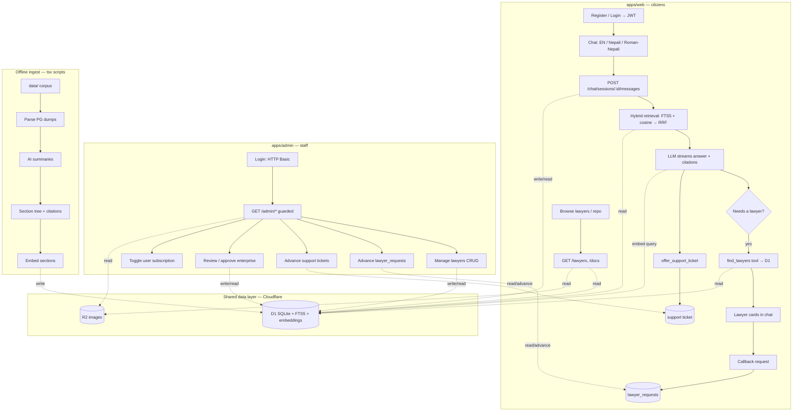

# Vidhan — Technical Documentation

Vidhan is a legal guidance assistant for Nepal. A citizen asks a question in English, Nepali
(Devanagari), or Roman-Nepali; the assistant retrieves the relevant provisions from a corpus of
Nepal government laws, answers with mandatory citations, and can escalate to a real lawyer
through an on-platform callback request. A separate admin app lets staff manage the lawyer
catalogue and work the request/support/enterprise queues.

This document is the entry point for anyone picking up the codebase. It covers the architecture,
the data model, every HTTP endpoint, the retrieval pipeline, environment configuration, local
setup, and the known gaps.

> Type everything. Zod is the single source of truth. Write in modules. These are enforced by
> `AGENTS.md` (see [Conventions](#conventions)).

---

## Table of contents

- [Overview](#overview)
- [Stack](#stack)
- [Repository layout](#repository-layout)
- [Architecture and data flow](#architecture-and-data-flow)
- [Data model](#data-model)
- [Retrieval (RAG)](#retrieval-rag)
- [Ingest and data pipelines](#ingest-and-data-pipelines)
- [API reference](#api-reference)
- [AI layer](#ai-layer)
- [Web app](#web-app)
- [Admin app](#admin-app)
- [Schema package](#schema-package)
- [Auth and security](#auth-and-security)
- [Configuration](#configuration)
- [Local development](#local-development)
- [Build, typecheck, lint](#build-typecheck-lint)
- [Deployment](#deployment)
- [Design decisions worth knowing](#design-decisions-worth-knowing)
- [Known gaps and follow-ups](#known-gaps-and-follow-ups)
- [Conventions](#conventions)

---

## Overview

Three user-facing surfaces, one backend:

| Surface | App | Audience | Auth |
|---|---|---|---|
| Chat + repository + lawyers | `apps/web` | Citizens | JWT (email/password) |
| Admin console | `apps/admin` | Vidhan staff | HTTP Basic |
| HTTP API | `apps/api` | Both frontends, seed scripts | mixed |

Core user journeys:

1. **Ask a legal question** — `/chat` surfaces a streamed answer with citation chips; when the
   matter needs a human, the assistant recommends lawyers from the catalogue.
2. **Browse the law** — `/repo` lists the source corpus (acts, the constitution, regulations);
   `/repo/[id]` renders the document tree section by section.
3. **Find and contact a lawyer** — `/lawyers` is a filterable catalogue; `/lawyers/[id]` is a
   profile. A lawyer is never contacted directly — the user files a callback request that staff
   work in the admin queue.
4. **Raise an issue / request enterprise access** — threaded support tickets and an enterprise
   request → approval → organization flow.

---

## Stack

| Layer | Choice |
|---|---|
| Runtime | Cloudflare Workers (`wrangler dev` on `:8787`) |
| API framework | Hono |
| Database | Cloudflare D1 (SQLite), accessed via Drizzle ORM |
| Keyword search | SQLite FTS5 (`document_nodes_fts`) |
| Semantic search | Section embeddings stored as BLOBs in D1, brute-force cosine in the Worker |
| Object storage | Cloudflare R2 (`IMAGES` binding) for lawyer portraits |
| AI | OpenRouter via the Vercel AI SDK (`ai` v5) for chat, titles, summaries, embeddings |
| Web / admin | Next.js 15 App Router, `output: "export"` (fully static), React 19, Tailwind v4, shadcn/ui |
| Monorepo | pnpm workspaces + **Nx** (not Turborepo) |
| Language | TypeScript strict (`noUncheckedIndexedAccess`, `verbatimModuleSyntax`), Zod |

The two Next apps are static exports: there is no server runtime for them. All data is fetched
client-side from the API. This drives several design constraints noted throughout.

---

## Repository layout

```
vidhan-hackathon/
├── apps/
│   ├── api/                    # Hono Worker — all server-side code
│   │   ├── src/
│   │   │   ├── index.ts        # app entry, Env type, CORS, error handlers
│   │   │   ├── db.ts           # drizzle(D1Database) factory
│   │   │   ├── routes/
│   │   │   │   ├── public/     # auth, chat, lawyers, lawyer-requests, docs,
│   │   │   │   │               # support, uploads, usage, enterprise
│   │   │   │   └── admin/      # lawyers, lawyer-requests, documents, support,
│   │   │   │                   # enterprise, stats, uploads, users
│   │   │   ├── ai/             # OpenRouter client, prompts, tools, embeddings
│   │   │   ├── chat/           # chat session/message persistence
│   │   │   ├── documents/      # public reader (list.ts) + RAG retrieval.ts
│   │   │   ├── rag/            # vectors.ts (cosine) + rrf.ts (rank fusion)
│   │   │   ├── ingest/         # offline seed generators (documents, summaries, embeddings)
│   │   │   ├── clean/          # offline LLM-assisted document cleaning
│   │   │   ├── seed/           # deterministic lawyer + portrait seeders
│   │   │   ├── usage/          # NPT-daily token metering
│   │   │   ├── enterprise/     # request/approval/organization lifecycle
│   │   │   ├── support/        # support ticket threading
│   │   │   ├── lawyer-requests/# callback leads
│   │   │   ├── lawyers/        # public catalogue queries
│   │   │   ├── uploads/        # R2 presign/serve helpers
│   │   │   ├── auth/           # PBKDF2 + HS256 JWT + requireAuth
│   │   │   └── lib/validate.ts # zod body parsing + error envelope
│   │   ├── wrangler.toml       # bindings, vars, dev port, migrations dir
│   │   └── .dev.vars           # local secrets (gitignored)
│   ├── web/                    # public chat/repo/lawyers UI (static export)
│   └── admin/                  # staff console (static export, port 3002)
├── packages/
│   └── schema/                 # @vidhan/schema — Drizzle tables + Zod schemas + types
│       ├── src/db/schema.ts    # single source of truth for every table
│       ├── src/chat-text.ts    # leaked-tool-call cleanup helpers
│       └── drizzle/            # generated migrations (+ hand-written FTS/price ones)
├── data/                       # source corpus, seed SQL artifacts, portraits
├── agent-docs/                 # per-sprint decision notes (historical, partly stale)
├── AGENTS.md                   # engineering guidelines
├── vidhan-flow.mmd             # Mermaid architecture diagram
└── nx.json, tsconfig.base.json, pnpm-workspace.yaml
```

Only `schema` is a shared package (two consumers: web + api). The RAG and AI code live as modules
inside `apps/api` because the Worker is their only consumer.

---

## Architecture and data flow



The canonical diagram lives at `vidhan-flow.mmd`.

**Runtime request path (chat):** the web app POSTs to `/chat/sessions/:id/messages` with a Bearer
token. The Worker checks the usage limit, inserts the user turn, assembles a system prompt with
prefetched sections, runs `streamText` with tools, streams an AI-SDK UI-message response, then
persists the assistant turn and meters tokens in `executionCtx.waitUntil`.

---

## Data model

All tables are defined in `packages/schema/src/db/schema.ts`. Drizzle is the only access layer
(`createDb(d1)` in `apps/api/src/db.ts`). Types are derived from Zod, never hand-written.

| Table | Purpose | Notes |
|---|---|---|
| `lawyers` | Catalogue + escalation target | JSON columns `practice_areas`, `languages`, `consultation_modes`, `courts`, `education`, `case_counts`; `seniority` mandatory; soft-delete via `active`; unique `bar_number`; no contact fields |
| `lawyer_requests` | On-platform callback leads | FK to lawyer + user; only `phone` is collected; status `pending\|contacted\|closed` |
| `documents` | One row per statute | `document_type` `act\|constitution\|regulation`; `summary` populated offline |
| `document_nodes` | Normalized recursive tree | Path id `{documentId}:{0.2.1}` (position-based); `nodeType` enum; precomputed `citation` |
| `document_node_embeddings` | Section vectors | `node_id` PK FK cascade; `vector` float32 LE, L2-normalized; separate table so FTS triggers don't churn |
| `document_nodes_fts` | FTS5 virtual table | External-content over `document_nodes(heading,title,content)`; **hand-written migration**, not in `schema.ts` |
| `users` | Accounts | PBKDF2 `password_hash`; `district`, `language`, `is_researcher`, `is_subscribed` |
| `user_usage` | Daily token meter | PK `(user_id, date)`; NPT day boundary |
| `chat_sessions` / `chat_messages` | Chat persistence | Messages carry `tool_calls`, `tool_results`, `references`, `reasoning` JSON |
| `support_tickets` / `support_ticket_messages` | Threaded issues | Ticket has **no body column**; opening message is the first row |
| `enterprise_requests` | Prospective org accounts | Approval fields null until approved; links to a support ticket |
| `enterprise_organizations` | Approved org | One per request; negotiated `approved_seats`, `tokens_per_member` |
| `enterprise_members` | Org seats | `user_id` null while invited; unique `(organization_id, email)` |

Key enums (all exported const tuples): `PRACTICE_AREAS`, `LANGUAGES`, `DISTRICTS` (all 77),
`CONSULTATION_MODES`, `COURTS`, `SENIORITY_LEVELS`, `DOCUMENT_TYPES`, `DOCUMENT_NODE_TYPES`,
`LAWYER_REQUEST_STATUSES`, `SUPPORT_TICKET_*`, `ENTERPRISE_*`. `USAGE_LIMITS = { free: 500_000,
subscribed: 5_000_000 }`.

Helper functions: `isDocumentContentNode` (container test — safe for unknown node types),
`nodeLabel` (first non-blank of heading/title/identifier), `asJson` / `asJsonObject` (JSON-column
branding for inserts).

### Migrations

Schema changes flow through Drizzle Kit; Wrangler applies the generated SQL because
`wrangler.toml` points `migrations_dir` at `packages/schema/drizzle`.

```pwsh
# after editing packages/schema/src/db/schema.ts
pnpm --filter @vidhan/schema db:generate
pnpm --filter @vidhan/api exec wrangler d1 migrations apply DB --local
```

Two migrations are hand-written because the Drizzle graph was blocked by merge conflicts:
`20261003020000_document_nodes_fts` (FTS5 table + triggers) and `20261004000000_lawyer_price`.
They have no snapshot; regenerate carefully if you re-run `db:generate`.

---

## Retrieval (RAG)

Two retrieval modes, deliberately separated:

- **Public repo reader** (`apps/api/src/documents/list.ts`) — SQL `LIKE` + pagination. No vectors.
- **Chat agent** (`apps/api/src/documents/retrieval.ts`) — hybrid FTS5 + cosine, fused with RRF.

### Hybrid chat retrieval

`hybridSearchSections(db, env, query, limit=8)`:

1. **FTS5 pass** over `document_nodes_fts`. The query is lowercased, split on non-word chars,
   stopworded (English + Nepali), each remaining token double-quoted and `OR`-joined. Ranked by
   `bm25(document_nodes_fts, 6.0, 6.0, 1.0)` — heading and title weighted 6× body. Exact terms
   (section numbers, Devanagari tokens, act names) survive because `unicode61` is used without a
   stemmer.
2. **Vector pass** — `embedQuery(env, query)` → `loadVectors(db, model)` → `cosineTopK(...)`.
   Embeddings are L2-normalized at rest and at query time, so cosine is a plain dot product.
   Vectors live in D1 and are scanned brute-force in the Worker (~1510 nodes × 1024 dims ≈ 6 MB,
   a few ms); Cloudflare Vectorize is intentionally not used. Loaded vectors are cached per
   isolate, keyed by model.
3. **RRF fusion** — `score = Σ 1/(60 + rank)` over the two ranked id lists. K=60 damps the tail so
   neither list dominates.
4. Vector-only hits get a metadata + snippet fetch; FTS hits already carry metadata. Results are
   returned in fused order.

**Fallback:** any failure in the vector path is caught and logged; retrieval degrades to FTS-only.
A turn must never fail because an embedding call or a missing seed did.

### Agent-facing read tools

The retrieval module exposes bounded reads so a 349-section code never lands whole in context:

- `getCompactOutline` — sections only, cap 40, optional heading filter.
- `getDocumentSummary` — stored summary + a flat section index capped at 80 entries.
- `getSections` / `getBoundedSection` — one or many node bodies, each truncated (default 6000
  chars) with `contentLength` + `truncated` flags.
- `searchDocumentSections` — the FTS5 search above.
- `resolveReferences` — resolves `cite`d node ids to display metadata; drops invented ids, dedupes,
  preserves model order.

### Citations

Citations are precomputed at ingest and stored on `document_nodes.citation`. Format:
`{document title}, {ancestor labels}, {label} ({heading})`, skipping `section_group` containers.
Example:

```
Domestic Violence (Offence and Punishment) Act, 2066 (2009), Section 3 (Domestic Violence not to be committed)
```

The model must repeat the stored string verbatim. Cited node ids are resolved to `TReference[]`
and stored on the assistant message; the web UI renders them as chips that deep-link to
`/repo/<documentId>?node=<nodeId>`.

---

## Ingest and data pipelines

The corpus and demo data are generated by offline `tsx` scripts under `apps/api/src` and loaded
into D1 with Wrangler. None of these run in the Worker import graph.

### Documents

`apps/api/src/ingest/documents.ts` parses the Postgres dumps in `data/documents-sql-inserts-test/`
(dollar-quoted JSONB — parsed, never executed), dedupes by id, walks the node tree, derives each
`heading` and `citation`, and writes `data/legal-documents.seed.sql`. It also writes the id list to
`apps/web/src/lib/document-ids.generated.ts` so the static export can enumerate `/repo/[id]` routes.
Node inserts are batched under a ~60 KB byte budget to stay below D1's ~100 KB statement cap
(`SQLITE_TOOBIG`).

### Summaries

`apps/api/src/ingest/summaries.ts` reads the local D1, cleans each document's text, asks
OpenRouter for a terse lead line + parts brief, and emits `data/documents.summaries.seed.sql`.
Run after documents are loaded. One retry on empty completion; flushes per document so paid
summaries survive a crash.

### Embeddings

`apps/api/src/ingest/embeddings.ts` embeds every content node (`isDocumentContentNode`) and emits
`data/document-embeddings.seed.sql`. Input is `heading || title + "\n" + content`, capped at 6000
chars. Idempotent via `content_hash = sha256(model + "\n" + text)`. **Must run after
`db:seed:documents:load`** — reseeding documents cascades the embeddings away via the FK.

### Cleaning

`apps/api/src/clean/documents.ts` is a separate, optional pass that mutates existing
`document_nodes.title` / `content` only — never `heading`, because citations key off it. Two
layers: deterministic normalization (`clean/normalize.ts`) and a surgical LLM edit-list
(`clean/llm.ts`, exact-once matches only, `temperature:0`). Safety nets: a conservation fingerprint
and post-edit content verification; any unexplained change reverts to the deterministic result.
Emits `data/documents.cleaned.seed.sql` + a report. `--no-llm` runs the deterministic layer only.

### Seeds (lawyers + images)

- `apps/api/src/seed/lawyers.ts` deterministically generates 150 lawyers, one per district for the
  first 77, and writes `data/lawyers.seed.sql`. Names/contacts are fictional. Portraits are
  assigned by first-name gender.
- `apps/api/src/seed/images.ts` uploads `data/portraits/{male,female}` into local miniflare R2
  using a pinned Miniflare version. Stop `wrangler dev` first (same sqlite).

### Command reference (run from repo root)

| Command | What it does |
|---|---|
| `pnpm --filter @vidhan/api db:seed` | Regenerate `lawyers.seed.sql` |
| `pnpm --filter @vidhan/api db:seed:load` | Load lawyers into local D1 |
| `pnpm --filter @vidhan/api db:seed:images` | Upload portraits to local R2 |
| `pnpm --filter @vidhan/api db:seed:documents` | Regenerate document seed + web id list |
| `pnpm --filter @vidhan/api db:seed:documents:load` | Load documents into local D1 |
| `pnpm --filter @vidhan/api db:seed:summaries` / `:load` | Generate / load document summaries |
| `pnpm --filter @vidhan/api db:seed:embeddings` / `:load` | Generate / load section embeddings |
| `pnpm --filter @vidhan/api db:clean:documents` / `:load` | Generate / load cleaned document text |

The lawyer and document seeds both `DELETE` their tables first, so `:load` is idempotent (local
dev only; admin-created rows are lost on reseed).

---

## API reference

Base URL: `http://localhost:8787` in dev. The Worker is a Hono app with global CORS and two error
handlers: `404 { error: "not_found" }`, `500 { error: "internal_error" }`.

### Conventions

- **Response envelope** — success wraps the resource: `{ lawyer }`, `{ lawyers, meta? }`,
  `{ ticket }`, `{ token, user }`. Failure is always `{ error: <snake_case> , details? }`.
- **Validation** — bodies are parsed with `parseJson` + Zod (`.catch(() => null)` tolerates bad
  JSON), returning `400 { error: "validation_error", details: <zod flatten> }`.
- **Auth** — `requireAuth()` requires `Authorization: Bearer <JWT>` (HS256, 7-day TTL) and loads
  the user into context. Admin routes require HTTP Basic for the whole `/admin/*` subtree.
- **Usage limit** — `POST /chat/sessions/:id/messages` returns
  `429 { error: "usage_limit_exceeded", used, limit, resetAt, isSubscribed }` when a user is at
  their daily cap.

### Public endpoints

`GET /` → `{ ok: true, service: "vidhan-api" }`.

**Auth** (`apps/api/src/routes/public/auth.ts`)

| Method | Path | Auth | Purpose |
|---|---|---|---|
| POST | `/auth/register` | — | Create account; returns `{ token, user }` (201). Activates pending enterprise invites. `409 duplicate_email` |
| POST | `/auth/login` | — | Returns `{ token, user }`; `401 unauthorized`. Constant-time on unknown emails |
| GET | `/auth/me` | Bearer | Current user |
| PATCH | `/auth/me` | Bearer | Partial update (`name`, `district`, `isResearcher`, `language`) |

**Chat** (`apps/api/src/routes/public/chat.ts`, all Bearer)

| Method | Path | Purpose |
|---|---|---|
| POST | `/chat/sessions` | Create session (201) |
| GET | `/chat/sessions` | List sessions (only those with messages) |
| GET | `/chat/sessions/:id` | `{ session, messages }` |
| DELETE | `/chat/sessions/:id` | Delete session + messages |
| POST | `/chat/sessions/:id/messages` | Body `{ content, mode }`; streams an AI-SDK UI-message response (reasoning + `data-title` part). `429` when over limit |

**Lawyers** (public, no auth)

| Method | Path | Purpose |
|---|---|---|
| GET | `/lawyers` | Filter by `practiceArea`, `district`, `language` (CSV), `seniority`, `limit` (max 200), `offset`. Returns `{ lawyers, meta:{ total, districtCounts? } }` |
| GET | `/lawyers/:id` | `{ lawyer }` detail incl. credentials; 404 |

**Lawyer requests** (Bearer)

| Method | Path | Purpose |
|---|---|---|
| POST | `/lawyer-requests` | Body `{ lawyerId, phone, preferredTime, mode?, note? }` (201); 404 if lawyer not public |
| GET | `/lawyer-requests` | Caller's requests, newest first |

**Documents** (public, no auth)

| Method | Path | Purpose |
|---|---|---|
| GET | `/docs` | Paginate (`page`, `limit`, `search`, `type`) |
| GET | `/docs/:id` | Document detail (summary, pages) |
| GET | `/docs/:id/outline` | Node tree without body text |
| GET | `/docs/:id/nodes/:nodeId` | Single node incl. body + citation |

**Support** (Bearer)

| Method | Path | Purpose |
|---|---|---|
| POST | `/support/tickets` | Body `{ subject?, message, category, source }` (201); deduped by first message while open |
| GET | `/support/tickets` | Caller's tickets |
| GET | `/support/tickets/:id` | Ticket + messages |
| POST | `/support/tickets/:id/messages` | Reply (reopens a closed ticket) |

**Uploads** (public read)

| Method | Path | Purpose |
|---|---|---|
| GET | `/uploads/:key` | Serve an R2 object with long-lived immutable cache headers (dev/fallback path) |

**Usage** (Bearer)

| Method | Path | Purpose |
|---|---|---|
| GET | `/usage` | `{ used, limit, resetAt, isSubscribed }`; enterprise seat overrides the plan limit |

**Enterprise** (Bearer)

| Method | Path | Purpose |
|---|---|---|
| POST | `/enterprise/requests` | Submit a request (one live request per user) + linked support thread (201) |
| GET | `/enterprise/requests/mine` | Caller's requests |
| GET | `/enterprise/membership` | `{ membership: { organizationId, organizationName, role } \| null }` |
| GET | `/enterprise/organization` | Caller's org + members (404 if none) |
| POST | `/enterprise/members` | Org admin adds a member by email; `403`/`409 seat_limit_exceeded`/`409 member_exists` |
| PATCH | `/enterprise/members/:id` | Activate/deactivate; cannot deactivate the org admin |

### Admin endpoints

All require HTTP Basic (`ADMIN_USERNAME` / `ADMIN_PASSWORD`); unconfigured credentials reject
outright. Credentials are compared as SHA-256 digests in constant time.

**Lawyers** (`apps/api/src/routes/admin/lawyers.ts`)

| Method | Path | Purpose |
|---|---|---|
| GET | `/admin/lawyers?active=` | List incl. resolved `imageUrl` |
| GET | `/admin/lawyers/:id` | Detail |
| POST | `/admin/lawyers` | Create (`ZLawyerCreate`); `409 duplicate_bar_number` |
| PATCH | `/admin/lawyers/:id` | Partial update |
| DELETE | `/admin/lawyers/:id` | Soft delete (`active=false`) |

**Lawyer requests**: `GET /admin/lawyer-requests`; `PATCH /admin/lawyer-requests/:id` (`{ status }`).

**Documents**: `GET /admin/documents` returns `[]` (stub); `POST /admin/documents` and
`POST /admin/documents/:id/summary` return `501 not_implemented`.

**Support**: `GET /admin/support/tickets?status=`; `GET /admin/support/tickets/:id`;
`POST /admin/support/tickets/:id/messages` (admin reply); `PATCH /admin/support/tickets/:id`.

**Enterprise**: `GET /admin/enterprise/requests?status=`; `GET .../requests/:id` (incl. thread);
`PATCH .../requests/:id` (status); `POST .../requests/:id/approve` (creates org, seats requester as
admin, posts to the support thread; `409 already_approved`); `GET /admin/enterprise/organizations`;
`GET /admin/enterprise/organizations/:id`.

**Stats**: `GET /admin/stats` returns `{ documents: 0, lawyers: 0, nodes: 0 }` (stub).

**Uploads**: `POST /admin/uploads/presign` (`{ contentType }` jpeg/png/webp) → signed R2 PUT ticket
(or a Worker dev URL when S3 creds are absent); `PUT /admin/uploads/dev/:key` (dev-only write).

**Users**: `GET /admin/users?page=&search=`; `PATCH /admin/users/:id` (`{ isSubscribed }`).

---

## AI layer

Provider wiring is in `apps/api/src/ai/`:

- `client.ts` — `createOpenAICompatible` pointing at `OPENROUTER_BASE_URL`; exposes `CHAT_MODEL`
  and `TITLE_MODEL` as env-driven models. There is no model fallback chain; `mode` changes the
  available tools, not the model.
- `embeddings.ts` — `EMBEDDING_MODEL` (default `baai/bge-m3`, 1024 dims), chosen so English,
  Roman-Nepali, and Devanagari share one vector space. `embedQuery` normalizes; `toBlob` packs
  float32 LE.
- `openrouter.ts` — raw-fetch helper used only by offline scripts (summaries, cleaning).
- `prompts.ts` — `chatSystemPrompt(language, district, prefetchedContext, mode)` and
  `TITLE_SYSTEM_PROMPT`.
- `tools.ts` — `buildTools(env, origin)`.

### Tools

| Tool | Input | Returns |
|---|---|---|
| `find_lawyers` | `{ practiceAreas[], district?, language?, reason? }` | Public lawyers (limit 5) + `districtCounts` fallback. **Dropped in research mode** |
| `get_document_titles` | — | Primary discovery: `{ id, title, documentType }` |
| `list_documents` | — | Full list (the prompt tells the model to prefer `get_document_titles`) |
| `search_documents` | `{ query, type? }` | Title/type search |
| `get_document_summary` | `{ documentId }` | Summary + section index (cap 80) |
| `get_document_outline` | `{ documentId, query?, limit? }` | Compact sections (cap 40) |
| `search_document_sections` | `{ query, limit? }` | Hybrid FTS+vector matches |
| `get_sections` | `{ documentId, nodeIds[], maxChars? }` | Batch bodies; merges descendant clauses, so a section reads complete even when ingest stored its text on child nodes |
| `get_section` | `{ documentId, nodeId, maxChars? }` | Single body; same subtree merge |
| `offer_support_ticket` | `{ category, message, reason }` | **No-op** — nothing is created until the user clicks the offer card |
| `cite` | `{ nodeIds[] }` | Resolved `TReference[]` (invented ids dropped, deduped) |

### Streaming and step budget

The chat route (`apps/api/src/routes/public/chat.ts`) runs `streamText` with:

- `prefetchSections` — top-5 hybrid hits injected into the system prompt before any tool call;
  sections that resolve to no text and descendants of other hits are dropped.
- `stopWhen: stepCountIs(7)`; by step 5 the model is forced to call `cite` (if not yet called) and
  `cite` is the only active tool; the last step removes all tools and appends a closing user turn
  asking for the final answer, so the turn ends in prose rather than a plan.
- If no `cite` ran (some providers ignore forced tool choices), the references fall back to the last
  `get_sections`/`get_section` read so the sources row is still populated.
- Reasoning is opt-in (`openrouter.reasoning = { enabled: true, max_tokens: 1024 }`) and streamed
  as a separate UI part.
- A transient `data-title` part carries the generated session title to the sidebar.
- OpenAI-style leaked tool-call text is stripped from the stored answer; leaked `cite` node ids are
  salvaged (`packages/schema/src/chat-text.ts`).

### Usage accounting

- Pre-flight: `getUsage` + `isOverLimit` → 429.
- On finish: `addUsage(userId, inputTokens + outputTokens)` inside `waitUntil`. Title generation is
  not metered.
- The day boundary is NPT (fixed UTC+5:45, no DST). `user_usage` is keyed by `(user_id, date)`, so
  the row boundary *is* the reset — no scheduler.
- An **active enterprise seat overrides the plan limit** with the organization's
  `tokens_per_member`.

---

## Web app

`apps/web` is a Next.js 15 App Router static export (`output: "export"`,
`transpilePackages: ["@vidhan/schema"]`). Because there is no server, everything is a client
component and remote images use plain `` (next/image does not work under export).

### Routes

| URL | Page |
|---|---|
| `/` and `/chat` | Chat (same `ChatView`; session in `?id=`) |
| `/lawyers` | Filterable, virtualized catalogue |
| `/lawyers/[id]` | Profile + callback request (pre-rendered per seed id) |
| `/repo` | Alphabetical, virtualized document list |
| `/repo/[id]` | Section reader with TOC + scroll-spy (pre-rendered per document id) |
| `/requests` | User's callback requests |
| `/support` | Ticket list or thread (`?id=`) |
| `/enterprise` | Organization overview / member management |
| `/enterprise/request` | Enterprise request form / status |
| `/account` | Profile + plan + usage meter (no sidebar) |
| `/login`, `/register`, `/privacy`, `/terms` | Auth + static legal pages |

Dynamic segments are pre-rendered at build time via `generateStaticParams` (lawyer ids from the
seed, document ids from `document-ids.generated.ts`). Runtime-only detail views (chat sessions,
support tickets) use `?id=` query params because the export cannot enumerate them.

### Chat feature

- `features/chat/store.tsx` — `ChatProvider` holds the session list and `mode`; history is fetched
  per session.
- `features/chat/components/chat-view.tsx` — `useChat` + `DefaultChatTransport` posts to the custom
  `/chat/sessions/:id/messages` endpoint with a per-request Bearer token. Creates a session on the
  first send, reads a streamed `data-title` part, refreshes usage on finish/error.
- `features/chat/adapt.ts` — converts AI-SDK parts into `TChatMessageView`: text, reasoning,
  citations (`ZCiteOutput`), lawyer search results (`ZPublicLawyer`), support offers, and an
  ordered retrieval "sources" trail. Rebuilds UI messages from persisted rows.
- Rendering: markdown bubbles, a collapsible thinking panel, source steps, a lawyer carousel,
  citation chips, and a consent-gated support offer card.

### Auth

JWT in `localStorage` (`vidhan:token`), `AuthProvider` verifies via `GET /auth/me`, and
`RequireAuth` redirects to `/login?next=…`. There is no global fetch interceptor — each feature's
`request()` helper attaches the bearer token. `src/lib/api.ts` holds a single `API_URL` (overridable
with `NEXT_PUBLIC_API_URL`, which static export inlines at build time; otherwise derived from the
runtime hostname so a phone on the LAN can reach `:8787`).

### Design language

Warm and soft: a single deep oxblood primary replaces black, warm off-white background, no cool
greys and no shadows, large radii (`--radius: 1.75rem`), Tailwind v4 CSS-first config, shadcn/ui
(new-york) vendored under `components/ui`, `next-themes` dark mode, `Inter Tight` wordmark font.

---

## Admin app

`apps/admin` is a static Next.js export on port 3002, used by staff only.

- **Auth:** a credential screen stores base64 `user:pass` in `localStorage`
  (`vidhan.admin.basic`); every request sends `Authorization: Basic …`. There is no login endpoint —
  credential validity is checked with `GET /admin/stats`. The token is browser-persisted (accepted
  trade-off).
- **Data layer:** TanStack Query per feature with key factories, `onSettled` invalidation, and one
  optimistic mutation (lawyer edit). Responses are Zod-parsed at the fetch boundary.
- **Pages:** `/login`; `/lawyers` (CRUD, enable/disable, verified toggle, image upload);
  `/lawyer-requests` (status queue); `/support` (threads, reply, close/reopen); `/enterprise`
  (requests + organizations, approval form, linked support thread); `/users` (subscription toggle).
- **Not present:** a document/repo admin page. `system-design.md` describes one, but it was never
  built; the admin app is lawyers, requests, support, enterprise, users only.

---

## Schema package

`@vidhan/schema` is source-first: `main`/`types`/`exports` all point at `./src/index.ts`, so
consumers need no build step. It exports Drizzle tables, Zod schemas, inferred types, enums, and
helpers.

Naming rules (`AGENTS.md`): Zod schemas `Z*`, inferred/derived types `T*`, Drizzle row types
`*Row` / `*Insert`. Select/insert/update schemas are built with `createSelectSchema` /
`createInsertSchema` / `createUpdateSchema` plus a refinements map; create/update omits
`id`/timestamps. Public projections (`ZPublicLawyer`, `ZPublicLawyerDetail`, `ZPublicDocument`,
`ZPublicUser`, …) deliberately hide internal fields — notably, no lawyer contact data ever reaches
a public surface.

`chat-text.ts` exports `stripToolCallText` and `extractLeakedCiteNodeIds`.

---

## Auth and security

- **Passwords** — PBKDF2-SHA256, 100k iterations, random 16-byte salt, stored as
  `pbkdf2$iterations$salt$hash` (base64url). Unknown emails still run a dummy hash so login timing
  can't enumerate accounts.
- **Sessions** — HS256 JWT signed with `JWT_SECRET`, 7-day TTL, verified with constant-time
  comparison; `requireAuth` re-loads the user on every request.
- **Admin** — HTTP Basic compared as SHA-256 digests in constant time; both fields are always
  compared even on failure.
- **Lawyer privacy** — phone/email/office/booking links are absent from the model by design. The
  only path from user to lawyer is a platform callback request; lawyer contact data is never
  returned to the public app.
- **R2** — presigned PUT with a 600 s TTL when S3 credentials exist; a dev-only Worker write route
  otherwise. Content types are pinned to jpeg/png/webp.

---

## Configuration

### API (`apps/api`)

Non-secret vars live in `wrangler.toml [vars]`; secrets and local overrides live in
`apps/api/.dev.vars` (gitignored) or via `wrangler secret put` in production:

| Variable | Purpose |
|---|---|
| `DB` / `IMAGES` | D1 and R2 bindings (from `wrangler.toml`) |
| `JWT_SECRET` | Signs auth tokens |
| `ADMIN_USERNAME` / `ADMIN_PASSWORD` | Admin Basic credentials |
| `OPENROUTER_API_KEY` / `OPENROUTER_BASE_URL` | AI provider |
| `CHAT_MODEL` / `TITLE_MODEL` | Model ids (env-driven) |
| `EMBEDDING_MODEL` / `EMBEDDING_DIMS` | Defaults `baai/bge-m3` / `1024` |
| `R2_ACCOUNT_ID` / `R2_BUCKET_NAME` / `R2_ACCESS_KEY_ID` / `R2_SECRET_ACCESS_KEY` | S3-compatible R2 access for presigning |
| `R2_PUBLIC_BASE_URL` | Public image base; falls back to `<origin>/uploads/<key>` |

`wrangler.toml` ships placeholder `database_id` and empty secrets — fill these before deploying.

### Frontends

- `NEXT_PUBLIC_API_URL` — API base for both Next apps. Inlined at build time by static export.
  When unset, the browser derives `http(s)://<hostname>:8787`, which is what makes LAN/phone
  testing work.

### Ports

| Service | Port |
|---|---|
| API (`wrangler dev`) | 8787 (bound to `0.0.0.0`) |
| Web (`next dev`) | 3000 |
| Admin (`next dev -p 3002`) | 3002 |

---

## Local development

Prereqs: Node ≥ 20, pnpm 12.6, a `wrangler` login only for remote work (local D1/R2 need none).

```pwsh
pnpm install

# 1. Apply migrations to local D1
pnpm --filter @vidhan/api exec wrangler d1 migrations apply DB --local

# 2. Seed data (order matters)
pnpm --filter @vidhan/api db:seed && pnpm --filter @vidhan/api db:seed:load
pnpm --filter @vidhan/api db:seed:documents && pnpm --filter @vidhan/api db:seed:documents:load
pnpm --filter @vidhan/api db:seed:summaries && pnpm --filter @vidhan/api db:seed:summaries:load
pnpm --filter @vidhan/api db:seed:embeddings && pnpm --filter @vidhan/api db:seed:embeddings:load
pnpm --filter @vidhan/api db:seed:images     # upload portraits (stop the API first)

# 3. Run each app in its own terminal (the user starts these)
pnpm api:dev      # http://localhost:8787
pnpm web:dev      # http://localhost:3000
pnpm admin:dev    # http://localhost:3002
```

The API reads `apps/api/.dev.vars` for secrets. A minimal local file needs `ADMIN_USERNAME`,
`ADMIN_PASSWORD`, `JWT_SECRET`, `OPENROUTER_API_KEY`, `OPENROUTER_BASE_URL`, `CHAT_MODEL`, and
`TITLE_MODEL`. Do not commit it; rotate any key that has ever been committed.

> Per `AGENTS.md`, do not start dev servers unless explicitly asked — an extra instance grabs the
> next port and causes confusion.

### Sharing the build with someone outside your network

`pnpm dev:api` in one terminal, then `pnpm share` in another. The script builds `apps/web/out`,
tunnels the API and the static site over Cloudflare Quick Tunnels, and prints the public URL.
Details and gotchas: `agent-docs/remote-sharing.md`.

---

## Build, typecheck, lint

From the repo root (Nx runs the targets across all projects):

```pwsh
pnpm build        # nx run-many -t build
pnpm typecheck    # nx run-many -t typecheck
pnpm lint         # nx run-many -t lint
```

Per project: `pnpm --filter @vidhan/api typecheck`, `pnpm --filter @vidhan/web typecheck`, etc.
The API "build" is `tsc --noEmit` (Wrangler bundles at deploy time). The web/admin builds are
`next build`, which also emits the static `out/` directory.

---

## Deployment

**API (Cloudflare Worker).** Create the D1 database and R2 bucket, paste the real `database_id`
into `wrangler.toml`, set secrets with `wrangler secret put` (`JWT_SECRET`, `ADMIN_USERNAME`,
`ADMIN_PASSWORD`, `OPENROUTER_API_KEY`, R2 keys), then:

```pwsh
pnpm --filter @vidhan/api exec wrangler d1 migrations apply DB --remote
pnpm --filter @vidhan/api deploy
```

**Web + admin.** `next build` produces static `out/` directories, deployable to Cloudflare Pages
(or any static host). Set `NEXT_PUBLIC_API_URL` to the deployed Worker origin **before** building,
since it is inlined into the bundle.

---

## Design decisions worth knowing

A non-exhaustive list of intentional choices that are easy to "fix" wrongly:

- **No vector database.** Embeddings are BLOBs in D1 and cosine-searched brute-force in the
  Worker. Cloudflare Vectorize has no local emulation; the corpus is small. Revisit at ~100k nodes.
- **No lawyer contact details, ever.** Reachability is only through `lawyer_requests`. The model
  deliberately has no phone/email/booking columns.
- **`practiceAreas` and `district` are closed enums.** The escalation verdict joins directly to SQL;
  adding a practice area is one line in `PRACTICE_AREAS` shared by the admin form and the prompt.
- **Soft-delete lawyers** (`active`) so a row never vanishes mid-conversation.
- **NPT day boundary via the `user_usage` primary key** — no cron, no stored reset timestamp.
- **Usage enforcement is pre-flight only** — an in-flight turn can push a user slightly over.
- **`offer_support_ticket` is a no-op** — consent-gated; the ticket is created by the client only
  after the user clicks.
- **Support tickets have no body column** — the opening message is the first threaded row.
- **Enterprise review happens in the linked support thread** — there is no separate messaging
  system.
- **Chat tool budget is 7 steps**, with `cite` forced by step 5 so the answer always ends in prose.
- **Retrieval degrades to FTS-only** on any vector-path failure.
- **Static exports drive routing choices** — `?id=` for runtime detail views, `localStorage` instead
  of cookies, plain `` instead of `next/image`.

---

## Known gaps and follow-ups

**Stubs**
- `GET/POST /admin/documents` and `POST /admin/documents/:id/summary` are `501`/empty placeholders.
  There is no admin UI for documents.
- `GET /admin/stats` returns zeros.

**Implementations that may deserve hardening**
- `enterprise.approveRequest` performs several writes without a transaction; a mid-way failure
  leaves partial state.
- `updateMemberStatus` resolves a platform user id on activation but does not persist it.
- Lawyer filtering/sorting/pagination is done in memory — fine for the mock catalogue, not at
  scale.
- Usage enforcement is not enforced mid-stream.
- Web feature modules each duplicate a small authenticated `request()` helper; there is no shared
  authenticated client.

**Documentation drift**
- `agent-docs/system-design.md` is an early draft (Turborepo, Cloudflare Vectorize two-stage
  summary→section RAG, `bookingUrl`, `city`) that no longer matches the code. Treat
  `agent-docs/` as historical context and trust the code plus this README.
- `agent-docs/database.md` predates embeddings and omits the FTS5 table; several sprint docs
  reference routes/columns that were removed (e.g. `/usage`, `/support/[id]`, `documents.status`).
- The docs reference a `docs/` directory that does not exist; the notes actually live in
  `agent-docs/`.

---

## Conventions

From `AGENTS.md`:

1. **Type first** — define types before logic; no `any`; prefer `z.infer` over hand-written types.
   Strict mode is on and must not be weakened.
2. **Naming** — schemas `Z*`, types `T*`, derive types from schemas.
3. **Shared types** — anything used by more than one app lives in `@vidhan/schema`.
4. **Modules** — reuse or extend before duplicating; think in contracts.
5. **Feature-based structure** — a feature owns its types, logic, and routes together.
6. **Comments** — sparse; comment only anomalies, never what the code already says.
7. **Decisions go to docs** — record non-obvious decisions as markdown in `docs/`.
8. **Dev servers** — never start one unless explicitly asked.
